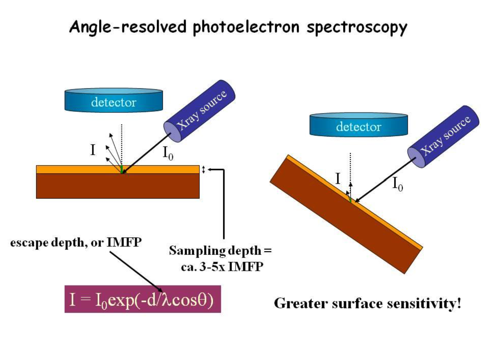

# Physics Simulations

A collection of Python-based computational and interactive
simulations exploring fundamental and applied physics.

## Available Simulations

### 1. Spherical Pendulum
Simulation of spherical pendulum dynamics based on
classical mechanics.

[Python Code](spherical_pendulum_python.py)

### 2. Interactive ARXPS Depth Simulation

### 2. Interactive ARXPS Depth Simulation

  
  

An interactive simulation of angle-resolved X-ray photoelectron spectroscopy (ARXPS).

**Features:**

- Photoelectron attenuation
- Inelastic mean free path (IMFP)
- Emission angle dependence
- XPS information depth
- Interactive sliders and visualization

[Python Code](ARXPS_depth_simulation.py)

## Requirements

- Python 3
- NumPy
- Matplotlib

Install dependencies:

    pip install numpy matplotlib

## Author

Aabiskar Subedi
Ph.D. Student in Physics
University of North Dakota
